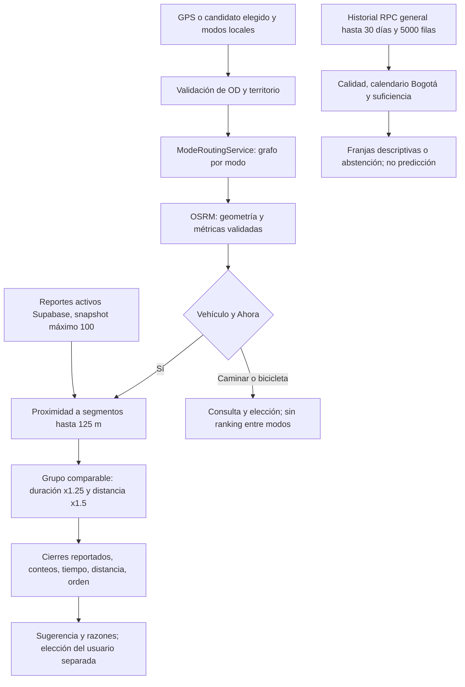

# Flujo implementado

Las ramas histórica y vehicular no forman un optimizador conjunto. Configuración remota de RPC y Realtime no queda acreditada por los fixtures. Véanse [funciones y casos](README.md).
