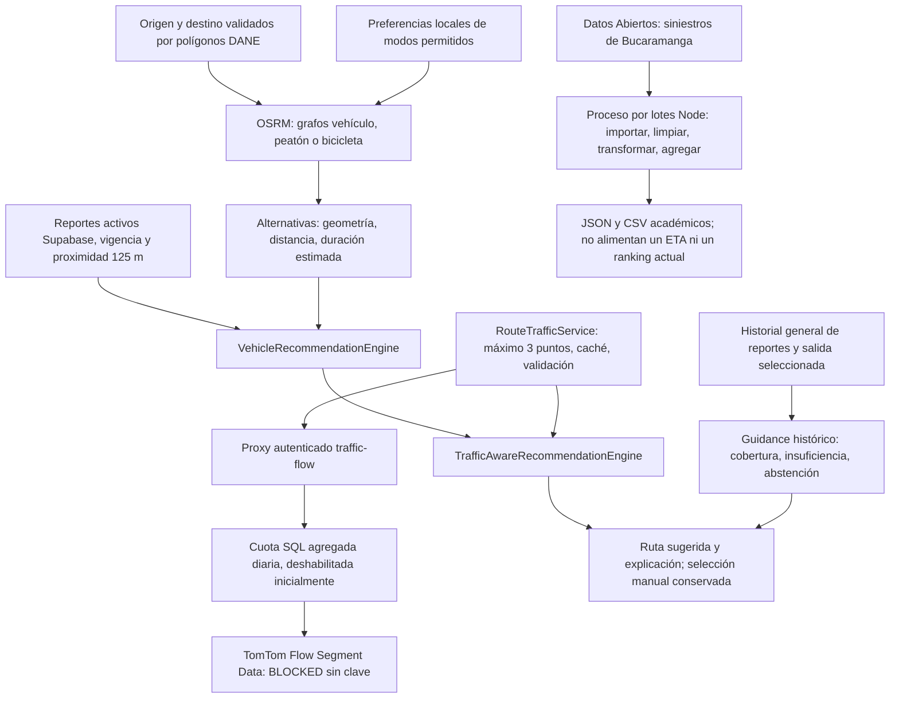

# Verificación final del objetivo específico 3

Corte: 16 de octubre de 2026, America/Bogota. Rama `feature/android-end-to-end-validation`.

**Resultado: subsanación parcial verificable, no cumplimiento integral del requisito de congestión en vivo.** Se implementó un adaptador real de tráfico y un proxy de servidor preparado localmente; su uso está **BLOCKED** porque el usuario confirmó que no dispone de API key TomTom. No hubo solicitudes a TomTom, despliegue, migración remota, contratación ni claves nuevas. Sí se ejecutaron procesamiento histórico oficial, nueve consultas reales OSRM, comparaciones con el motor existente y regresiones automatizadas. El APK de esta intervención mantiene el proveedor de tráfico deshabilitado.

Los archivos originales y resultados de los cortes del 14, 15 y del primer corte del 16 permanecen separados. Esta intervención no convierte los videos anteriores en pruebas de una nueva versión.

## 1. Arquitectura y alcance implementado



El motor vehicular conserva métricas OSRM. Selecciona menor duración y desempata por distancia y orden del proveedor. Con snapshots de incidentes para todas las alternativas, compara las que cuestan como máximo 25 % más de duración y 50 % más de distancia respecto de la más rápida; prioriza ausencia de cierres reportados y menor cantidad de incidentes próximos. La proximidad no demuestra bloqueo ni sentido. Sin snapshots completos no afirma ausencia de incidentes.

La personalización verificable consiste en origen/destino, modo seleccionado, modos guardados en el dispositivo y salida elegida. No existe perfil aprendido, preferencias de comodidad/costo inferidas, IA entrenada ni puntuación contextual numérica. Vehículo, peatón y bicicleta usan grafos diferentes y sus métricas pueden compararse; el motor de recomendación sigue siendo vehicular. No se elige automáticamente un ganador multimodal. Transporte público carece de fuente integrada.

El nuevo decorador conserva esa decisión y añade una explicación de modos permitidos y disponibilidad de tráfico. Un fragmento próximo no permite identificar carril/sentido ni cubrir una ruta completa: **no se usa para recalcular ETA o reordenar alternativas**. Sin proveedor, se informa la degradación y se remite al historial general de salida programada. El historial continúa siendo descriptivo; si falta RPC o cobertura devuelve error/insuficiencia, no inventa datos.

## 2. Archivos y funciones reales

| Archivo | Función o responsabilidad |
|---|---|
| `lib/services/osrm_routing_service.dart` | `routeAlternatives`, `_parseRoute`, `_parseInstructions`: solicitud y parser de métricas/geometría reales |
| `lib/services/mode_routing_service.dart` | `route`: selección del grafo para el modo; transporte público no soportado |
| `lib/services/mobility_preferences_service.dart` | `load`, `save`: conjunto de modos local; fallo de almacenamiento no se convierte en preferencia vacía |
| `lib/mobility/vehicle_recommendation_engine.dart` | `recommend`: regla vehicular existente y límites de comparación |
| `lib/mobility/route_incident_analyzer.dart` | `analyze`: vigencia, deduplicación y distancia punto-segmento |
| `lib/mobility/traffic_aware_recommendation_engine.dart` | `recommend`: nuevo decorador explicable; conserva métricas y decisión |
| `lib/services/route_traffic_service.dart` | `inspect`, `validate`, `distanceToLine`: consulta acotada, procedencia, frescura, confianza y correspondencia geométrica |
| `lib/widgets/map_search_panel.dart` | `_recommendWithTraffic`: integrado en cálculo, cambio a vehículo y refresco de incidentes; conserva descarte de respuestas obsoletas |
| `lib/widgets/mobility_recommendation_summary.dart` | Explicación de indisponibilidad o fragmento parcial, sin atribuir tráfico completo |
| `lib/mobility/analytics/historical_departure_guidance.dart` | Evaluador existente: días completos, cobertura por día/hora, abstención con datos insuficientes |
| `supabase/functions/traffic-flow/handler.mjs` | `createHandler`: autenticación inyectada, geocerca, cuota, timeout, caché y redacción de errores |
| `supabase/functions/traffic-flow/index.ts` | Wrapper Deno: verificación de usuario con Auth, llamada al RPC y secreto de servidor |
| `supabase/traffic-quota.sql` | `consume_traffic_quota`: techo agregado UTC, consumo atómico reservado a service_role; propuesta sin aplicar |
| `tools/mobility-history.mjs` | `aggregate`: limpieza y agregados históricos; CLI con métricas y hash |
| `tools/collect-osrm-evidence.mjs` | Nueve consultas secuenciales identificadas, timeout 15 s y pausa 1,1 s |
| `tools/summarize-objective-3.mjs` | Exportación reproducible de tablas de alternativas y resumen cuantitativo |

Los GeoJSON del proxy son copias de los tres assets DANE existentes. Su licencia/procedencia se conserva en `assets/geo/README.md`; no se amplió la cobertura para aceptar resultados.

## 3. Tráfico actual: fuente, seguridad y bloqueo

Fuente evaluada: [TomTom Flow Segment Data v4](https://docs.tomtom.com/traffic-api/documentation/tomtom-maps/v1/traffic-flow/flow-segment-data). Endpoint sin clave: `https://api.tomtom.com/traffic/services/4/flowSegmentData/absolute/18/json`, unidades km/h. El proveedor describe velocidades, tiempos de fragmento y confianza. Su [matriz](https://docs.tomtom.com/traffic-api/documentation/tomtom-maps/v1/product-information/market-coverage) incluye Colombia; esto **no acredita cobertura calle por calle** en los tres municipios. La documentación recomienda evaluar Orbis para integraciones nuevas antes de una contratación.

El contrato conserva proveedor/endpoint, fecha UTC de consulta, coordenada, currentSpeed/freeFlowSpeed, currentTravelTime/freeFlowTravelTime, confidence y desviación máxima frente a la geometría. Se rechaza confianza < 0,8, antigüedad > 120 s, fecha futura, valores inválidos, cierre, procedencia/coordenada distinta o separación > 25 m. Son umbrales locales conservadores, no calibrados físicamente. El tiempo de consulta no es un timestamp individual de cada medición subyacente del proveedor.

Cliente: un vértice central por alternativa, máximo tres alternativas secuenciales, timeout 5 s, caché 60 s/100 entradas, revalidada por geometría. Servidor: JWT y usuario Auth verificados, polígonos oficiales, timeout 4 s, caché efímera 60 s/100 entradas, cuota SQL diaria compartida que nace apagada. Sin SQL/configuración válida falla cerrado. Las cabeceras, claves y cuerpos de error del proveedor no se devuelven ni registran.

**Estado A tráfico real: BLOCKED, cero solicitudes. Cobertura local y latencia TomTom: NOT TESTED.** No equivale a decir que Colombia carece de cobertura. Wrapper Deno, despliegue, permisos SQL, cuota persistente y consumo concurrente remoto: NOT TESTED. Las pruebas Node verifican el handler con dependencias controladas, no prueban el servicio desplegado. Ver [instrucciones de habilitación](../../../../supabase/functions/traffic-flow/README.md).

## 4. Dataset histórico real y procesamiento

Fuente: [3. Accidentes de Tránsito ocurridos en el Municipio de Bucaramanga](https://www.datos.gov.co/d/7cci-nqqb), publicado por Alcaldía de Bucaramanga, Santander. La licencia registrada en los [metadatos descargados](intervention-2026-10-16/dataset-metadata.json) es **CC BY-SA 4.0**. Se conserva atribución; la proyección y los agregados se comparten bajo esa licencia. No se solicitaron campos de propietarios de vehículos.

| Medida ejecutada | Resultado |
|---|---:|
| Filas recibidas en una solicitud limitada a 50.000 | 39.193 |
| Válidas | 39.190 |
| Descartadas por fecha/hora inválida o ausente | 3 |
| Rango temporal de filas válidas | 2012-01-01 a 2023-09-30 |
| Tamaño de la proyección JSON | 7.828.609 bytes |
| Lectura, parseo, limpieza y agregación local | 477,3919 ms |
| Agregados por mes, día semanal, hora, comuna y gravedad | 196 |
| Con heridos / con muertos / solo daños | 18.982 / 606 / 19.602 |

SHA-256 del JSON recibido: `9252e26f61aa9c3080b2f65509254bd4da7bd9a8561de319167b2ad11bcb42bf`.

Variables: orden (deduplicación), fecha (validación estricta y calendario), hora civil (se extrae HH:mm:ss; 1899 en ese campo es fecha auxiliar), gravedad, comuna y contadores automóvil/moto/bicicleta/peatón (validación de enteros no negativos). Se normaliza texto, rechazan IDs duplicados/categorías desconocidas y se comprueba que cada dimensión agregada conserve el número de registros válidos. La ejecución no encontró duplicados descartables. Ver [descartes](intervention-2026-10-16/historical-rejected-temporal.json), [resultado](intervention-2026-10-16/historical-analysis.json) y [CSV](intervention-2026-10-16/historical-groups.csv).

El límite y una sola descarga no certifican integridad histórica del portal ni ausencia de subregistro. Son **siniestros históricos**, no congestión, aforos, velocidad o exposición al riesgo. Menor cantidad por hora no implica mejor horario: faltan denominadores y correspondencia por corredor. Este proceso se ejecuta fuera del APK; no introduce esos datos antiguos en el ranking actual ni en el dashboard de reportes de usuarios. Es procesamiento por lotes de escala definida, **no una plataforma Big Data distribuida**.

## 5. Comparación cuantitativa reproducible

Se consultaron los mismos extremos para cada modo. Destino común: Parque Santander, `7.1196763, -73.1228536`. Orígenes proceden de las referencias OSM conservadas, con comprobación contra polígonos antes de consultar:

| Caso | Origen (latitud, longitud) | Vehículo, alternativa 1 (m / s) | Peatón, alternativa 1 (m / s) | Bicicleta, alternativa 1 (m / s) |
|---|---|---:|---:|---:|
| real-1 | UIS, Bucaramanga: 7.1409311, -73.1198652 | 4.021,4 / 421,5 | 3.010,6 / 2.410,7 | 3.354,1 / 897,8 |
| real-2 | Floridablanca: 7.0625677, -73.0859086 | 9.041,5 / 539,3 | 9.698 / 7.779,8 | 10.027,7 / 2.585,9 |
| real-3 | Girón: 7.0690690, -73.1700282 | 10.455,2 / 630,5 | 12.348,8 / 9.881,2 | 12.892,2 / 3.567,4 |

Nueve respuestas HTTP 200/Ok, **14 alternativas** en total. URL, extremos, instante UTC, SHA del cuerpo y tiempo de consulta están en [provider-requests.json](intervention-2026-10-16/provider-requests.json); los cuerpos originales permanecen al lado. Los grafos peatonal/ciclista se seleccionan por endpoint, no cambiando arbitrariamente el nombre de perfil de un grafo vehicular. Véase el [contrato OSRM](https://project-osrm.org/docs/v5.24.0/api/).

Referencia cuantitativa: primera alternativa OSRM suministrada. Diferencia = recomendada − referencia; porcentaje = 100 × diferencia / referencia (null si denominador cero). Ejemplo real-1: la segunda alternativa vehicular tiene 327,1 m menos (−8,13 %) pero 36,2 s estimados más (+8,59 %). El motor conserva la primera por duración. No se afirma que haya ahorro real ni que el tiempo del servidor sea tiempo de recorrido.

| Escenario de recomendación | Naturaleza | Cambio de elección | Δ duración estimada | Δ distancia |
|---|---|---|---:|---:|
| controlled-clear | Rutas e incidentes controlados | osrm-0 → osrm-0 | 0 s / 0 % | 0 m / 0 % |
| controlled-incident | Mismos extremos, un incidente sintético próximo a osrm-0 | osrm-0 → osrm-1 | +20 s / +20 % | +200 m / +9,09 % |
| controlled-missing | Sin snapshots de incidentes | osrm-0 → osrm-0 | 0 s / 0 % | 0 m / 0 % |
| real-1-driving | Respuesta real capturada; sin incidentes/tráfico observados | osrm-0 → osrm-0 | 0 s / 0 % | 0 m / 0 % |
| real-2-driving | Respuesta real capturada; sin incidentes/tráfico observados | osrm-0 → osrm-0 | 0 s / 0 % | 0 m / 0 % |
| real-3-driving | Respuesta real capturada; una alternativa | osrm-0 → osrm-0 | 0 s / 0 % | 0 m / 0 % |

Las comparaciones ejecutan el parser OSRM y el motor reales. El replay sustituye solo el transporte HTTP por los bytes originales: **no es una nueva consulta en vivo**. Los casos B no representan incidentes registrados en Supabase ni desplazamientos humanos.

Se obtuvieron razones no vacías en 6/6 escenarios (100 % en este conjunto pequeño, no porcentaje de calidad general). No hay puntuación contextual numérica. Cobertura útil de tráfico en estas ejecuciones: cero observaciones disponibles; cobertura comercial local desconocida. [comparisons.json](intervention-2026-10-16/comparisons.json) registra entradas, todas las alternativas, razones, exposición y microsegundos locales de cada ejecución. Son medidas únicas, con arranque frío y overhead de prueba, sin inferencia estadística ni garantía de latencia Android. Exportaciones: [comparisons.csv](intervention-2026-10-16/comparisons.csv), [real-mode-comparison.csv](intervention-2026-10-16/real-mode-comparison.csv).

Los 12 casos deterministas previos se volvieron a ejecutar en este corte: [scenarios.json](intervention-2026-10-16/scenarios.json). Incluyen modos, cambio de métricas, desempate, incidente, datos faltantes, preferencias incompatibles, historial insuficiente (99 registros), historial sintético denso con resultado descriptivo y abstención ante historial truncado. El historial denso no se presenta como un dataset observado ni una hora óptima por corredor.

## 6. Pruebas y evidencia auténtica

| Grupo | Resultado | Evidencia |
|---|---|---|
| A: proveedores reales OSRM | PASS: 9/9 HTTP 200/Ok; 14 alternativas | requests, cuerpos originales, hashes y log de colección |
| A: TomTom real | BLOCKED: sin clave; cobertura local NOT TESTED | confirmación del usuario y cliente deshabilitado |
| B: Flutter determinista, suite completa final | PASS: 769 aprobadas, 0 fallidas, 0 omitidas | `tests-machine-final.log`, `tests-command-final.json`, `flutter-test-results.json` |
| B: regresiones nuevas Flutter | PASS: 11 del adaptador + 4 de comparación | `focused-tests-4.log`; nombres en la suite completa |
| B/C: Node handler y transformación | PASS: 6, 0 fallidas | `node-tests.log`, tests `.test.mjs` |
| C: dataset observado | PASS: 39.193 recibidas; 39.190 válidas; 3 rechazadas | fuente, metadatos, análisis, grupos CSV y log |
| Análisis estático final | PASS: sin incidencias | `analyze-verified.log`, command JSON |
| Whitespace Git | PASS: salida 0 | `diff-final.log` |
| Wrapper Deno/SQL/despliegue remoto | NOT TESTED | no se aplicaron cambios al servidor |
| D: Android nuevo APK | Consultar acta de este corte | `android-observation.json`, versión y hashes; no extrapolar videos anteriores |

Los primeros intentos fallidos se conservan: `focused-tests.log` y `focused-tests-2.log` detectaron dependencia de una etiqueta de UI no importada; `focused-tests-3.log` detectó replay HTTP con codificación Latin-1 en la prueba. Se corrigió el decorador independiente de UI y el replay UTF-8. No se ocultaron ni se reinterpretaron esos fallos iniciales como PASS. El resultado final corresponde a fuentes posteriores a esas correcciones.

Reproducción, desde la raíz, sin nuevas dependencias:

```powershell
$sourceEvidence='docs/evidence/fdc125/04-objetivo-3/intervention-2026-10-16'
$runEvidence='artifacts/objective-3-reproduction'
New-Item -ItemType Directory -Force $runEvidence | Out-Null
Copy-Item "$sourceEvidence/provider-requests.json" -Destination $runEvidence
Get-ChildItem $sourceEvidence -Filter 'real-?-*.json' | Copy-Item -Destination $runEvidence
node tools/mobility-history.mjs "$sourceEvidence/historical-source.json" $runEvidence
node --test tools/mobility-history.test.mjs supabase/functions/traffic-flow/handler.test.mjs
$env:OE3_EVIDENCE_DIR=$runEvidence
flutter analyze --no-pub
flutter test --no-pub --machine
node tools/summarize-objective-3.mjs $env:OE3_EVIDENCE_DIR
git diff --check
```

La reproducción escribe en `artifacts/` y conserva el corte sellado. El valor de `OE3_EVIDENCE_DIR` es necesario también para evitar que la prueba de auditoría anterior escriba en su ubicación histórica predeterminada. La colección de proveedor se ejecutó una sola vez; para nuevas consultas usar otro directorio y `node tools/collect-osrm-evidence.mjs <directorio>` (requiere red; nueve solicitudes acotadas). No forma parte de tests automáticos.

## 7. Correspondencia con el objetivo aprobado

**NOT TESTED: falta el texto literal del objetivo 3 del F-DC-124 aprobado.** Se solicitó al usuario; la redacción provisional del repositorio no se cita como documento institucional confirmado. La siguiente correspondencia usa únicamente las exigencias expresas de esta intervención y deberá sustituirse por frases literales cuando se aporte el aprobado.

| Exigencia recibida | Evidencia que sí existe | Brecha |
|---|---|---|
| Procesamiento de datos de movilidad | Parser OSRM, vigencia/proximidad de reportes y 39.193 filas históricas con limpieza/agregados | No procesamiento distribuido ni alta escala operativa demostrada |
| Congestión en tiempo real | Adaptador/proxy local y controles de calidad; reportes propios existentes | TomTom real BLOCKED; ningún retraso observado incorporado al ranking |
| Recomendaciones personalizadas de rutas | Extremos, modo permitido, métricas y exposición, razones legibles y selección manual | Sin perfil aprendido, sin validación de superioridad de resultados en campo |
| Horarios | Historial general con condiciones de suficiencia y abstención | Sin historial por corredor, predicción u horario óptimo; dataset de siniestros no resuelve esa brecha |
| Medios de transporte | Consultas reales para tres grafos; métricas por modo, preferencias locales | Sin ganador multimodal automático, transporte público ni costos/aforos |
| Resultados cuantitativos frente a referencia | JSON/CSV, diferencias absolutas/relativas y tiempo de ejecución | No ahorros de viaje medidos ni estudio representativo de usuarios |

## 8. Recomendación para el F-DC-125 y brechas

Presentar el trabajo como **prototipo verificable de procesamiento por lotes y reglas explicables**, con comparación de estimaciones y análisis de incidentes, no como sistema Big Data ni optimizador basado en tráfico vivo completado. Adjuntar tablas, hashes, fuente licenciada, comandos y videos auténticos asociados a su versión conocida.

Para cerrar la exigencia estricta de tráfico vivo falta: obtener clave y autorizar presupuesto/cuota; verificar contrato/licencia; probar el proxy y SQL en staging; observar segmentos locales autorizados y registrar calidad/correspondencia; implementar identificación de sentido y cobertura suficiente antes de que esos datos puedan modificar duración o ranking. Requiere otra validación y otro APK si se habilita. No basta añadir una key para afirmar una recomendación basada en congestión validada.

Para horarios falta historial georreferenciado por corredor, continuidad temporal y denominadores apropiados. Para recomendaciones de medio preferido falta definir con el usuario criterios medibles adicionales al conjunto permitido. Ninguna de esas capacidades se atribuye a los resultados actuales.

## 9. Versión y protección Git

Nueva versión generada en este corte: **1.0.2+2026101601**, release con firma de depuración existente, únicamente demostración académica. [Fuente exacta](intervention-2026-10-16/source-state.sha256): 233 archivos; SHA del manifiesto `b2445ac61e770177230074e8f84cb070ea0064074ca5ecf36c4d740d01bf102a`. De los 215 archivos inventariados en la versión 1.0.1, solo cambiaron los dos widgets indicados; los demás archivos de esta intervención son nuevos. El dataset y los scripts de procesamiento son evidencia externa al APK.

El acta `intervention-2026-10-16/version.json` vincula APK, SHA, firma, suite y fuente. La carpeta de entrega es `deliveries/objective-3-intervention-20261016/`; los APK del 14 y el primer corte del 16 se conservan. El stash y `pubspec.lock` previo permanecen intactos; hash protegido del lock: `cf0ea1843a277fb73974690d7759d01fda55f02983292e6562b68b2691a443c3`. Sin commit, push ni PR. Git contiene además los cambios locales anteriores, que no deben atribuirse íntegramente a esta intervención.

## 10. APK e instalación observada del corte D

| Comprobación | Resultado |
|---|---|
| APK fuera de build | `deliveries/objective-3-intervention-20261016/transporte-inteligente-1.0.2-2026101601-release-debug-signed.apk` |
| Tamaño | 60.331.195 bytes |
| SHA-256 | `435913b6c1eb08ace49d80005f7b20d4561a1428fa9d254ba45a769384d9eb40` |
| Compilación | PASS, salida nativa 0; Gradle 190,3 s; sin cambio de firma |
| Firma | PASS v2; CN=Android Debug; no producción |
| Certificado SHA-256 | `27b98872756c1a1e6dea44defae811127be4dbf7f6e1c666dab9a8757c9d5a85` |
| Identidad Android | `com.example.transporte_inteligente`, 1.0.2 / 2026101601, minSdk 24 / targetSdk 36 |
| Assets Bucaramanga/Girón/Floridablanca | PASS: tamaño y SHA del ZIP idénticos a assets originales; copias del proxy también idénticas |
| OAuth en manifiesto empaquetado | PASS: `transporteinteligente://login-callback/`; manejador Flutter desactivado según configuración anterior |
| Dispositivo | Samsung S22 SM-S901U, R3CT30HX60V, Android 15/API 35 |
| Instalación exacta | PASS: `adb install -r` respondió Success, versión instalada comprobada y hash de `base.apk` idéntico |
| Apertura del componente | PASS: `am start -S -W` Status ok, MainActivity, WaitTime 3122 ms |
| Interfaz visible y pruebas funcionales | NOT TESTED: pantalla inicialmente apagada; al encenderla seguía el bloqueo/NotificationShade sobre la actividad enfocada. Se solicitó desbloqueo al usuario |

No se confunde el éxito de un intent con la validación de Home o una sesión Google nueva. La captura local `artifacts/objective-3-android/s22-launch.png` muestra Always On Display; no se publica como demostración de la app. La [matriz AND-01 a AND-10](intervention-2026-10-16/android-matrix.md) conserva el pendiente humano de autenticación, GPS, rutas, modos y navegación.

El primer comando de orquestación interpretó `$LASTEXITCODE` de un script PowerShell como si fuera un ejecutable nativo y se detuvo antes de instalar. El log de assets ya era PASS; se corrigió la comprobación del comando y se repitió con errores terminantes. `assets-verification-final.log`, `install-command.json` y `launch-command.json` corresponden a la comprobación efectiva. No fue un fallo del APK ni una instalación fallida encubierta.
