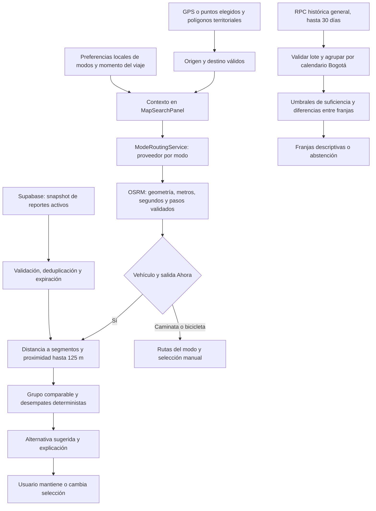

# Validación del objetivo 3: procesamiento y recomendaciones

Auditoría: **15 de octubre de 2026, America/Bogota**. Rama: `feature/android-end-to-end-validation`.

## Conclusión y autoridad académica

Existe un modelo **determinista y explicable** de recomendación vehicular, con procesamiento de alternativas y proximidad de reportes. También existen routing separado para vehículo, caminata y bicicleta y orientación histórica descriptiva de horarios. **No existe un recomendador integrado que elija conjuntamente ruta, horario y medio según prioridades personales.** No se identificó IA, ML, infraestructura Big Data ni proveedor de tráfico en vivo.

La [matriz de trazabilidad](requirements/traceability_matrix.md) declara «FDC-124 NO LOCALIZADO». Contiene esta referencia provisional del OE3: «Construir un modelo de procesamiento y análisis de información de movilidad para recomendaciones personalizadas de rutas, horarios y medios». **No es una cita institucional verificada.** Se solicitó al usuario el texto literal aprobado; la correspondencia exacta con F-DC-124 queda **NO VERIFICADA** hasta recibirlo. No se reconstruye ni modifica unilateralmente el objetivo aprobado.

Documentos históricos como `mobility-objectives-completion.md` y la matriz describen etapas anteriores sin routing caminando/bicicleta o sin historial. Para esta auditoría prevalecen el código actual y su ejecución; no se usan esas afirmaciones antiguas para negar capacidades que hoy sí existen.

## Flujo datos → procesamiento → reglas → resultado



La rama histórica se muestra al seleccionar **Programar**. No modifica duraciones OSRM ni puntúa la ruta. Programar no consulta tráfico futuro ni habilita navegación futura. Realtime actualiza snapshots y sugerencias sin requerir otra consulta OSRM por ese evento; conserva la selección manual. El recálculo por desvío GPS es un flujo distinto.

## Componentes reales auditados

| Archivo y función | Entradas, procesamiento y salida |
|---|---|
| `lib/mobility/mobility_context.dart`: `MobilityContext`; `route_option.dart`: `RouteOption.fromRouteResult` | Extremos, modos permitidos, fecha, geometría, métricas e incidentes por ID; validación de consistencia |
| `lib/services/mobility_preferences_service.dart`: `load/save` | Modos guardados en SharedPreferences por instalación; no por cuenta ni con pesos personales de tiempo/costo |
| `lib/services/mode_routing_service.dart`: `route`; `lib/config/osrm_config.dart` | Proveedores separados car/foot/bike. Público no soportado. La consulta por modo no calcula un ganador entre medios |
| `lib/services/osrm_routing_service.dart`: `routeAlternatives`, `_requestRoutes`, `_parseRoute`, `_parseInstructions` | Solicita `alternatives=true`, `steps=true`, `overview=full`, GeoJSON y coordenadas lon,lat. Valida territorio/respuesta y conserva metros, segundos y maniobras disponibles |
| `lib/services/road_incident_service.dart`: `fetchActiveReports/createReport/watchChanges`; `lib/controllers/road_incident_controller.dart`: `refresh/publish` | Tabla `reportes_viales`, sesión al publicar, máximo 100 reportes activos, deduplicación, debounce de 350 ms y eliminación de expirados cada minuto |
| `lib/mobility/route_incident_analyzer.dart`: `analyze` | Distancia a segmentos mediante proyección local, umbral 125 m; excluye inválidos/expirados/duplicados; produce conteos, categorías y cierre reportado |
| `lib/mobility/vehicle_recommendation_engine.dart`: `recommend`; `vehicle_recommendation_policy.dart` | Elegibilidad driving, menor duración → distancia → orden; con snapshots completos aplica grupo comparable y exposición a reportes |
| `lib/mobility/decision/current_mobility_decision_adapter.dart`: `build`; `mobility_decision_coordinator.dart`: `decide` | Disponibilidad y decisión vehicular tipada; el coordinador envuelve evaluación existente, no consulta ni vuelve a clasificar |
| `lib/widgets/map_search_panel.dart`: `_calculate`, `_chooseMode`, `_applyNonVehicle`, `_analyzeIncidents`, `_withIncidents`, `_refreshIncidentRecommendation`, `_planningOptions` | Integra servicios, evita resultados obsoletos, distingue sugerencia/selección y presenta historial. `_applyNonVehicle` limpia la recomendación vehicular: caminar/bici no se presentan como ganador personalizado |
| `lib/services/supabase_mobility_analytics_repository.dart`: `fetch`; `lib/mobility/analytics/mobility_analytics.dart`: `MobilityAnalyticsEngine.aggregate` | RPC histórica versión 1, fechas UTC, calidad/truncamiento; agrega categorías y periodos, no velocidades ni tiempos de viaje |
| `lib/mobility/analytics/historical_departure_guidance.dart`: `HistoricalDepartureGuidanceEvaluator.evaluate`; controlador `HistoricalDepartureGuidanceController.load`; widget `HistoricalDepartureGuidanceCard` | Calendario Bogotá, suficiencia, franjas de menor actividad y abstención; ventana hasta 30 días, caché 10 minutos y textos de limitación |

### Datos observados, reglas y capacidades ausentes

Las fuentes operacionales son Geolocator, OSRM, Supabase y eventos Realtime. **Esta auditoría no consultó servicios remotos ni insertó reportes**: los casos siguientes usan fixtures declarados. El código cliente no verifica por sí solo tablas, RLS, publicación Realtime o disponibilidad del proveedor.

Origen/destino fijan consulta y geometría. Las preferencias limitan elegibilidad por modo; sin preferencias se comunica driving por defecto. No hay prioridades personales de tiempo, costo o accesibilidad, aprendizaje por usuario, sincronización de preferencias por cuenta ni recomendación automática entre modos. Elegir manualmente no equivale a recomendar.

La regla vehicular valida rutas/IDs/extremos. Sin snapshots completos: menor duración, luego distancia, luego orden del proveedor. Con snapshots completos: compara alternativas hasta **25 % más de duración y 50 % más de distancia** que la más rápida; dentro de ese grupo evita cierres reportados si hay opción, minimiza reportes próximos y desempata por duración/distancia. No añade demoras a OSRM. Proximidad no acredita bloqueo, sentido de circulación o ruta segura.

El máximo operacional de 100 reportes puede omitir otros activos. Cero coincidencias describe solo el snapshot disponible, no ausencia de congestión. El motor comprueba IDs coincidentes, pero no impone por sí mismo un TTL a análisis externos: la vigencia depende del caller/controlador.

El historial utiliza `AnalyticsObservation(category, createdAt, expiresAt, status)`: **no contiene coordenadas, usuario o ruta**. El SQL propuesto `docs/supabase/mobility_analytics.sql` requiere sesión, devuelve hasta 5000 filas y detecta truncamiento; declara aplicación manual, no verificada aquí. Proyecta solo tipo, fechas y estado. El evaluador cuenta registros históricos, incluidos estados aceptados activo/cancelado y registros expirados; no representa exclusivamente incidentes vigentes ni volumen de tráfico.

Para orientar exige >=28 días completos, >=100 registros en días completos, >=4 fechas del día de semana elegido, >=12 registros por cada una de esas fechas y, en sus 24 franjas, >=4 registros distribuidos en >=3 fechas. Solo diferencias entre franjas permiten `observed`. Lotes truncados, filas excluidas o ventana posterior a evaluación producen `partial`; vacío produce `empty`; muestra escasa o uniforme se abstiene. Son umbrales descriptivos, no confianza estadística validada ni predicción causal.

## Casos deterministas ejecutados

Archivo: [test/objective_3_validation_test.dart](../test/objective_3_validation_test.dart). Se ejecutan los componentes reales, con HTTP inyectado en OE3-01 y lotes/reportes en memoria. **Los datos sintéticos no se presentan como respuestas OSRM consultadas hoy, registros reales de Supabase o mediciones físicas.** No se sembró historial artificial en producción.

Unidades: segundos y metros. OD de OE3-01/02/03/04/07/08: fixture `(7.1,-73.1) → (7.2,-73.2)`. OE3-05/06 usan geometrías de pruebas espaciales `(0,0) → (0,0.02)`; desvío por `(0.003,0.01)`. No son rutas reales de Bucaramanga ni verifican cobertura territorial. El routing simulado usa el límite rectangular de pruebas; las geocercas reales se prueban en suites separadas.

| Caso y nombre del test | Entradas | Salida obtenida | Resultado |
|---|---|---|---|
| OE3-01 mismo OD delega tres modos y rechaza transporte público | Respuestas HTTP fixture: car 120 s, foot 900 s, bike 300 s; cada una 1000 m | Tres solicitudes a servicios distintos conservan OD/métricas; público no soportado; sin ganador multimodal | PASS |
| OE3-02 duración cambia sugerencia con mismo OD | a=180 s/1000 m; b=120 s/2000 m; c=200 s/500 m | Sugiere b; explica menor duración; conserva a/c como alternativas | PASS |
| OE3-03 duración cambia sugerencia con mismo OD | Mismas entradas excepto b=240 s/2000 m | Cambia a a=180 s/1000 m; c más corta no gana por política temporal | PASS |
| OE3-04 empate en duración se explica por distancia | a=120 s/2000 m; b=120 s/1000 m | Sugiere b; explicación explícita del desempate por distancia | PASS |
| OE3-05 snapshot de incidentes cambia sugerencia | a=100 s/2200 m; b=120 s/2400 m; snapshots completos sin reportes | Conteos a=0/b=0; sugiere a | PASS |
| OE3-06 snapshot de incidentes cambia sugerencia | Mismas rutas; accidente activo de fixture en `(0,0.01)`, próximo a a y fuera de 125 m de b | Conteos a=1/b=0; sugiere b, sin modificar sus métricas | PASS |
| OE3-07 preferencia sin driving no produce vehículo ni comparación multimodal | Modos permitidos: walking; candidata driving | `NoEligibleVehicleRouteException`; no inventa ganadora caminando | PASS |
| OE3-08 falta de snapshot no equivale a cero incidentes | a=100 s/1000 m; b=120 s/1100 m; sin análisis | Sugiere a por duración; no afirma «sin reportes» | PASS |
| OE3-09 historial insuficiente se abstiene de orientar | Ventana 28 días; solo 99 registros del generador | `insufficient`, sin franjas; texto «Datos insuficientes para orientar horarios» | PASS |
| OE3-10 historial suficiente solo describe menor actividad observada | 1316 registros sintéticos, 28 días, cuatro miércoles; salida elegida miércoles 08:00 | `observed`; franja 08:00 con 4 reportes en 4 fechas frente a 8 en las otras franjas | PASS |
| OE3-11 cambiar registros cambia franja; lote parcial se abstiene | Intercambiar horas civiles 08/16; por separado truncar lote original | Franja cambia a 16:00; lote truncado queda `partial` y sin franjas | PASS |
| OE3-12 Programar no produce recomendación futura | Ruta vehicular actual disponible; salida programada al día siguiente | `hasRecommendation=false`, razón `insufficientEvidence` | PASS |

Salidas literales y entradas serializadas: [scenarios.json](evidence/objective-3/2026-10-15/scenarios.json). Log: [scenarios-test.log](evidence/objective-3/2026-10-15/scenarios-test.log), **12 pruebas aprobadas**. Las excepciones esperadas son verificaciones PASS, no fallos ocultados.

Comparación causal de software: OE3-02→03 cambia solo duración y cambia selección; OE3-05→06 cambia solo reportes y cambia selección. La ruta b de OE3-06 cumple límites de 125 s y 3300 m; no se supone retraso real de a. OE3-08 distingue fuente ausente de snapshot vacío. OE3-09→10→11 demuestra suficiencia, respuesta a datos y abstención por truncamiento. Ninguno demuestra reducción de congestión o satisfacción de usuarios.

Periodo histórico fixture: `[2026-09-09T05:00Z,2026-10-07T05:00Z)`, 28 días completos Bogotá. Salida seleccionada: `2026-10-14T13:00Z`, miércoles 08:00. Generador: un registro/hora a :10 más otro a :20 excepto hora 08; 47×28=1316. El motor vehicular usa reloj de fixture `2026-09-25T12:00Z` y el análisis espacial `2026-09-27T12:00Z`: conjuntos independientes, no telemetría real del prototipo. El caso suficiente demuestra una capacidad condicional del algoritmo; **no demuestra que la base real posea esa muestra**.

## Correspondencia con la referencia provisional del OE3

| Componente del objetivo | Evidencia | Conclusión rigurosa |
|---|---|---|
| Modelo de procesamiento/análisis | Parseo, validación, análisis espacial, agregación y comparación | Implementado para datos acotados; no depende de atribuir IA |
| Recomendaciones de rutas | Motor vehicular, motivos y selección separada | Implementado en vehículo, condicionado a candidatas recibidas |
| Personalización | OD y modos locales | PARCIAL: faltan prioridades personales y evaluación de utilidad |
| Horarios | Historial general con suficiencia/abstención | PARCIAL: no hora óptima por corredor, usuario o tráfico futuro |
| Medios | Routing driving/walking/cycling y elección manual | PARCIAL: sin recomendación entre medios ni transporte público integrado |
| Texto literal F-DC-124 y aceptación institucional | Original no localizado; texto solicitado | NO VERIFICADO; no certificar cumplimiento total |

Si el texto aprobado exige recomendar conjuntamente rutas, horarios y medios con personalización completa, **la evidencia actual no basta para declarar OE3 cumplido integralmente**. La directora debe contrastar el alcance con el objetivo aprobado; no se cambia el objetivo para acomodarlo al código.

## Matriz Android AND-01 a AND-10

Completar por observación humana con fecha/hora, persona, modelo/Android, versionCode, SHA-256, pasos, resultado literal y captura/log. Estados: PASS / FAIL / NOT TESTED. «Lo probaré» no acredita PASS. La instalación/apertura observadas el 14/10 están en `android-release-validation.md`; esta matriz nueva no inventa su reejecución el 15/10.

| ID | Acción y prerrequisito | Resultado esperado verificable | Estado | Observación humana / evidencia |
|---|---|---|---|---|
| AND-01 | Instalar APK 1.0.0, código 20261014, verificar hash y abrir | Versión correcta; login/Home visible sin cierre inesperado | NOT TESTED | Pendiente |
| AND-02 | Elegir personalmente cuenta Google en nuevo login | Retorno a app y sesión efectiva; navegador abierto no basta | NOT TESTED | Pendiente |
| AND-03 | GPS preciso y extremos conocidos en municipios permitidos | Ubicación coherente, validación territorial; Piedecuesta excluida como extremo | NOT TESTED | Pendiente |
| AND-04 | Confirmar búsqueda y elegir candidato conocido | Precisión/ambigüedad explícitas; marcador y ruta corresponden al candidato | NOT TESTED | Pendiente |
| AND-05 | Vehículo, Ahora, consultar ruta y motivos | Métricas y explicación; si hay una candidata declararlo; selección manual distinta de sugerencia | NOT TESTED | Pendiente |
| AND-06 | Mismo OD en caminata y bicicleta | Métricas propias o error/no ruta transparente; no prometer mejor modo automático | NOT TESTED | Pendiente |
| AND-07 | Reporte real legítimo próximo, o entorno aislado de pruebas autorizado | Snapshot/explicación actualizados si hay candidatas comparables; no alterar segundos OSRM ni crear reportes ficticios en producción | NOT TESTED | Pendiente |
| AND-08 | Cambiar preferencias locales y volver a evaluar | Elegibilidad coherente; sin sugerencia vehicular si driving no permitido | NOT TESTED | Pendiente |
| AND-09 | Programar y consultar historial real | Diferenciar error RPC, vacío, insuficiente, parcial y franjas; suficiente solo con muestra real verificable, sin promesa futura | NOT TESTED | Pendiente |
| AND-10 | Ruta válida Ahora; pasajero/prueba supervisada | GPS, giro 2D, pausa por arrastre, recentrado e instrucciones; registrar fallos | NOT TESTED | Pendiente |

No se inició una sesión nueva, publicó un reporte ni recorrió una ruta física durante esta auditoría. No manipular el teléfono al conducir.

## Pruebas y reproducción

```text
flutter test --no-pub --reporter expanded test/objective_3_validation_test.dart
flutter analyze --no-pub
flutter test --no-pub --reporter expanded
git diff --check
```

Validación completa: **PASS**. `flutter analyze --no-pub`: sin incidencias (86,2 s), código 0. `flutter test --no-pub --reporter expanded`: **754 aprobadas, 0 fallidas** (1 min 8 s), código 0. `git diff --check`: código 0. Los 12 casos nuevos están incluidos en las 754; no se suman dos veces. Registros reales en [evidencia](evidence/objective-3/2026-10-15/): `scenarios-test.log`, `scenarios.json`, `flutter-analyze.log`, `flutter-test.log`, `git-diff-check.log`, `exit-codes.txt`. El test regenera scenarios.json; las ejecuciones siguientes deben conservar su contexto de fecha y datos sintéticos.

Suites complementarias: `test/services/mode_routing_service_test.dart`, `test/mobility/vehicle_recommendation_engine_test.dart`, `test/mobility/route_incident_analysis_test.dart`, `test/screens/home/incident_route_flow_test.dart`, `test/widgets/multimodal_mobility_test.dart`, `test/mobility/analytics/historical_departure_guidance_test.dart` y `test/widgets/historical_departure_guidance_test.dart`. Cubren fallos tipados, límites espaciales/comparables, expiración, orden estable, caché y presentación. El test «Realtime actualiza selector abierto…, conserva selección y no llama OSRM» verifica integración con dobles; no certifica un canal remoto real. Los logs completos conservan nombres/resultados individuales.

## Cierre de la observación y propuesta acotada

1. Presentar a la directora este informe, JSON y ejecución de OE3-02/03, 05/06 y 09/10/11. Mostrar las entradas modificadas y motivos literales, sin atribuir mediciones de impacto inexistentes.
2. Incorporar el texto aprobado del F-DC-124, confirmar criterios y registrar aceptación del alcance parcial o las brechas exigidas. No declarar cumplido lo pendiente.
3. Completar AND-01..10 en el S22. Para orientación histórica operacional faltan verificar RPC/permisos y disponibilidad de registros reales; un fallo o muestra insuficiente es evidencia documentable, no motivo para inventar datos.
4. Si se exige una mejora funcional inmediata, proponer un comparador entre modos ya soportados con prioridad explícita del usuario por duración o distancia, desempate estable y explicación. Reutilizar servicios actuales; no resolvería por sí solo horario por corredor o tráfico. **No implementado: requiere aprobación y nuevo APK/versionCode antes de atribuirlo a la entrega.**

## APK y seguridad Git

No se modificó funcionalidad en `lib/`, Android, assets, dependencias o credenciales. Se añadió únicamente el test de demostración y documentación/evidencia. **No se generó ni sustituyó un APK.** La entrega del 14/10 mantiene versión 1.0.0, código 20261014, release con firma debug, SHA-256 `040768c25ab2075125957dafe47939f82e57f4299c0a8a78b48b5ef4236fc6c3`. Verificación final **PASS**: el SHA-256 del APK coincide y los **128 archivos** del manifiesto de fuentes conservan sus hashes. Evidencia: [preservation.json](evidence/objective-3/2026-10-15/preservation.json). Los tests nuevos no cambian el APK instalado.

Rama y diferencias anteriores conservadas. `pubspec.lock` previo: SHA-256 `cf0ea1843a277fb73974690d7759d01fda55f02983292e6562b68b2691a443c3`. Stash `cc2b34eb080858401908a211262d299111bfd4fe`, sin aplicar/borrar. Sin reset, clean, restore, commit, push ni PR. El estado completo se conserva en evidencia; no todas las diferencias del working tree pertenecen a esta fase.
